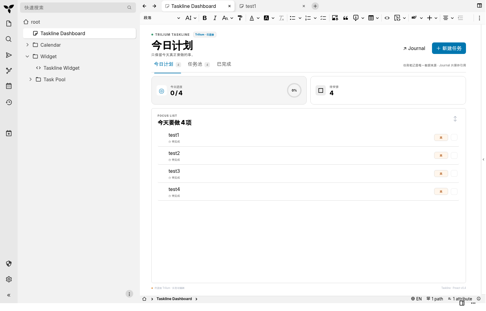
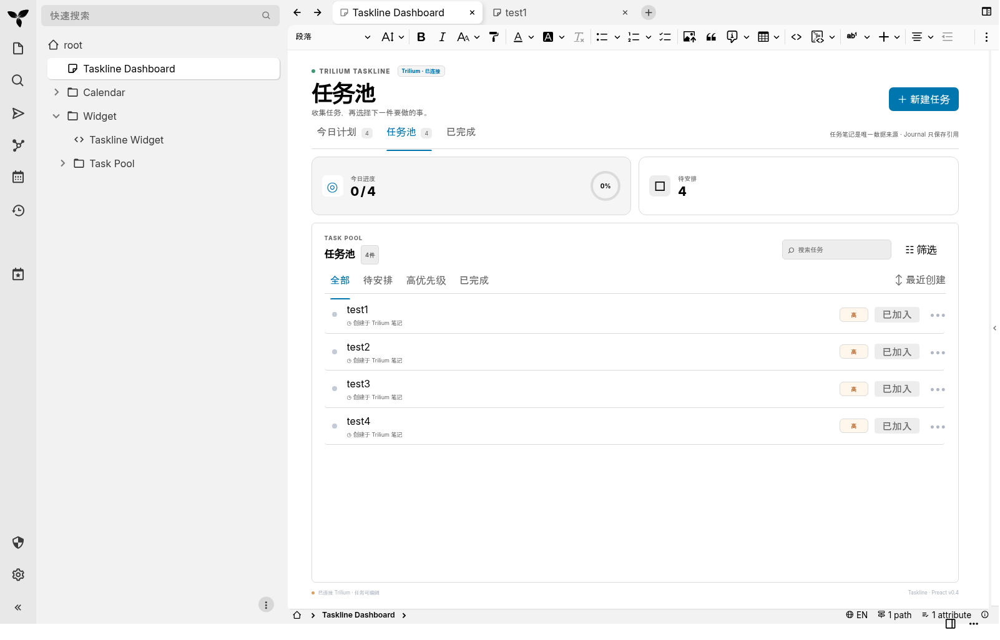
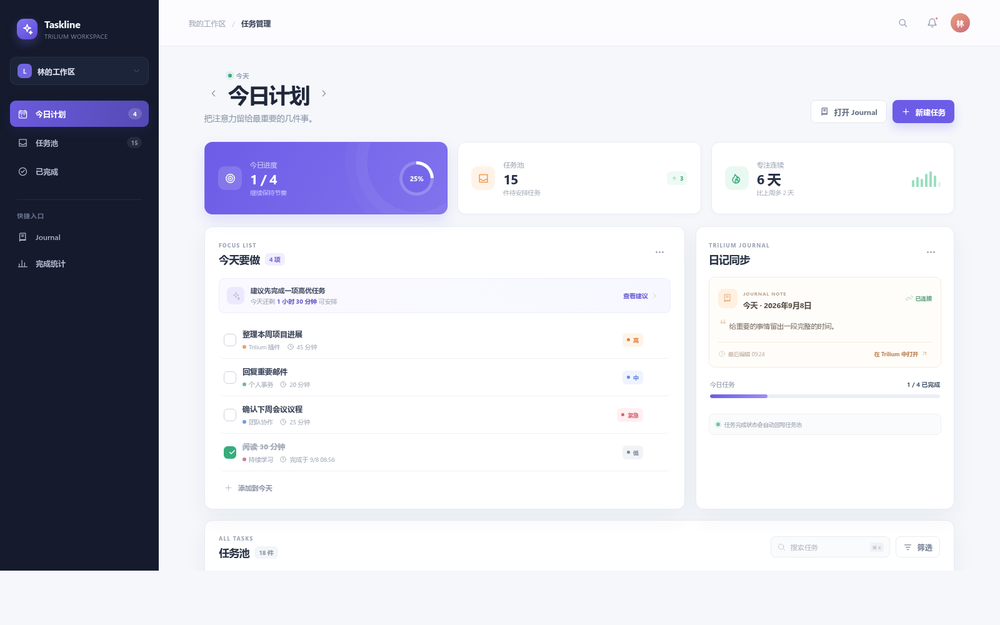
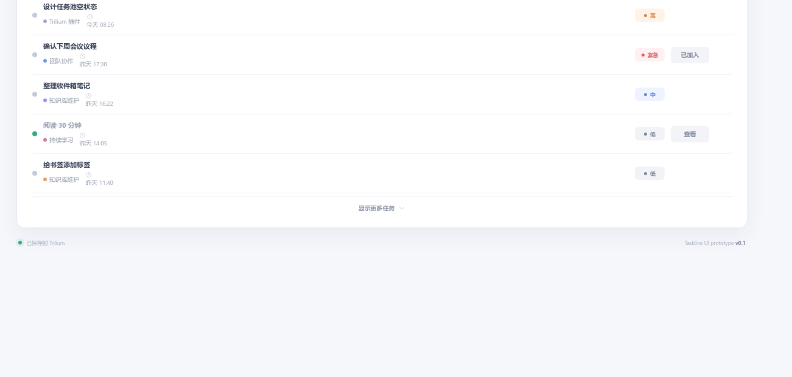

# Taskline

> 面向 TriliumNext 的轻量任务工作台：把「任务池 → 今日计划 → Journal」串成一条专注流。

Taskline 目前提供两种形态：

- **独立 UI 原型**：无需构建工具，直接在浏览器中体验完整交互。
- **TriliumNext Widget**：以 JSX/Preact Code Note 的方式运行，读取 `#task` 笔记，并将计划与当天 Journal 关联。

## Trilium 中的实际效果

以下截图来自 **TriliumNext v0.105**：Taskline Widget 已安装为 JSX/Preact Custom Widget，并在带有 `#taskDashboard` 标签的笔记中运行。左侧笔记树、顶部编辑器工具栏和 Dashboard 标签页均为 Trilium 原生界面。

### 今日计划与 Trilium 工作区



### Trilium 中的任务池



## 独立 UI 原型预览

下面的图片仅用于展示独立浏览器原型的视觉方案，不代表 Trilium 内嵌效果：





更多预览图位于 [`docs/images/`](docs/images/)。

## 功能

### 独立原型

- 今日计划、任务池、已完成、Journal、完成统计视图
- 前一天 / 后一天计划切换
- 任务搜索、状态筛选、优先级排序
- 从任务池加入或移出指定日期计划
- 勾选完成、恢复任务，并记录完成时间
- 新建任务：标题、项目、优先级、预计用时、是否加入计划
- 查看任务详情与 Journal 连接状态

独立页面的数据保存在浏览器内存中，刷新页面后会恢复演示数据；它主要用于体验交互和视觉方案。

### TriliumNext 集成

- 读取带有 `#task` 标签的真实任务笔记
- 支持 `#taskPool`，并兼容旧标签 `#taskRoot`
- 按年度 / 月度目录组织任务
- 任务正文直接使用 Trilium 笔记内容
- 通过 `taskStatus`、`taskPriority`、`taskPlannedDate` 等标签保存任务状态
- 加入计划时，在当天 Journal 中维护任务表格与任务链接
- 使用左侧 Launchbar 一键打开 Dashboard
- 没有任务池时自动回退到演示数据

## 快速开始：浏览器预览

项目没有 Node.js 构建步骤，使用 Python 启动静态文件服务器即可：

```bash
git clone https://github.com/rainfd/trilium-tasks.git
cd trilium-tasks
python3 -m http.server 4173 --bind 127.0.0.1
```

打开 <http://127.0.0.1:4173>，即可体验原型。

也可以直接双击打开 `index.html`；使用本地 HTTP 服务时，部分浏览器兼容性更好。

## 安装到 TriliumNext

### 方式一：安装脚本（推荐）

先在 Trilium 的 ETAPI 设置中创建 Token，然后运行：

```bash
python3 scripts/install-taskline.py \
  --server http://127.0.0.1:8090 \
  --token YOUR_ETAPI_TOKEN
```

脚本会创建或更新以下笔记，并自动建立当前年度 / 月度目录：

- `Taskline Widget`
- `Taskline Launchbar`
- `Task Pool`
- `Taskline Dashboard`

安装完成后，在 Trilium 中打开 **Global menu → Configure launchbar → Add a custom widget**，选择 `Taskline Launchbar`，保存并刷新界面。

如果使用 GitHub Raw 文件，也可以不下载整个项目：

```bash
curl -fsSL https://raw.githubusercontent.com/rainfd/trilium-tasks/main/scripts/install-taskline.py | \
  python3 - \
  --server https://trilium.example.com \
  --token YOUR_ETAPI_TOKEN \
  --widget-url https://raw.githubusercontent.com/rainfd/trilium-tasks/main/taskline-widget.jsx \
  --launcher-url https://raw.githubusercontent.com/rainfd/trilium-tasks/main/taskline-launcher.jsx
```

> Token 只通过命令行参数或交互输入使用，安装脚本不会保存 Token。不要把 Token 写入仓库、Shell 历史或截图。

### 方式二：手动粘贴 Code Note

详细步骤见 [`TRILIUM_V0105.md`](TRILIUM_V0105.md)。核心配置如下：

1. 将 `taskline-widget.jsx` 粘贴到 JSX Code Note，并添加 `#widget`。
2. 创建任务池笔记，添加 `#taskPool`（兼容 `#taskRoot`）。
3. 创建 Dashboard 笔记，添加 `#taskDashboard`。
4. 如需启动栏入口，将 `taskline-launcher.jsx` 粘贴到另一个 JSX Code Note；**不要**添加 `#widget`。
5. 在 Launchbar 配置中添加该启动器。

修改已有任务、计划日期或 Journal 链接前，需要在 Trilium 的 **Security** 设置中启用 **Backend Script**。只读展示和创建不加入计划的任务不依赖该开关。

## Docker 本地测试

项目提供了 TriliumNext v0.105.0 的本地测试配置：

```bash
docker compose up -d
```

Trilium 默认暴露在 <http://127.0.0.1:8090>，数据写入本地 `.trilium-data/`。该目录包含数据库、日志和会话密钥，已通过 `.gitignore` 排除，**不要提交到 GitHub**。

停止服务：

```bash
docker compose down
```

## 任务标签约定

任务笔记至少添加 `#task`，常用属性如下：

```text
#task
#taskStatus=inbox|todo|doing|done
#taskPriority=urgent|high|medium|low
#taskPlannedDate=2025-01-15
#taskEstimate=30
#taskProject=Trilium 插件
```

任务正文就是任务描述。Taskline 会通过 `plannedIn` relation 将计划任务关联到当天 Journal。

## 项目结构

```text
.
├── index.html                 # 独立原型入口
├── app.js                     # 原型交互与演示数据
├── styles.css                 # 原型视觉样式
├── taskline-widget.jsx        # TriliumNext v0.105+ Widget
├── taskline-launcher.jsx      # Trilium Launchbar 启动器
├── scripts/
│   └── install-taskline.py    # ETAPI 安装 / 更新脚本
├── docs/images/               # 项目效果图
├── TRILIUM_V0105.md           # Trilium 手动安装与配置说明
├── docker-compose.yml         # 本地 Trilium 测试环境
└── .gitignore                 # 本地数据与敏感文件排除规则
```

## 当前范围

这是一个可运行的 UI 原型与 Trilium 集成版本，不是独立的多人任务服务：

- 独立页面没有后端持久化、登录和多端同步。
- Journal 写入、任务属性更新依赖 Trilium ETAPI / Backend Script。
- Widget API 面向 TriliumNext v0.105+；其他版本可能需要调整导入 API 或 Widget 配置。
- `taskline-widget.js` 是保留的旧版 jQuery Widget，仅用于旧环境兼容；新安装优先使用 JSX 版本。
- 目前没有自动化测试与打包流程，改动后建议分别在浏览器原型和 Trilium 实例中验证。

## 许可证

MIT License。详见 [`LICENSE`](LICENSE)。
